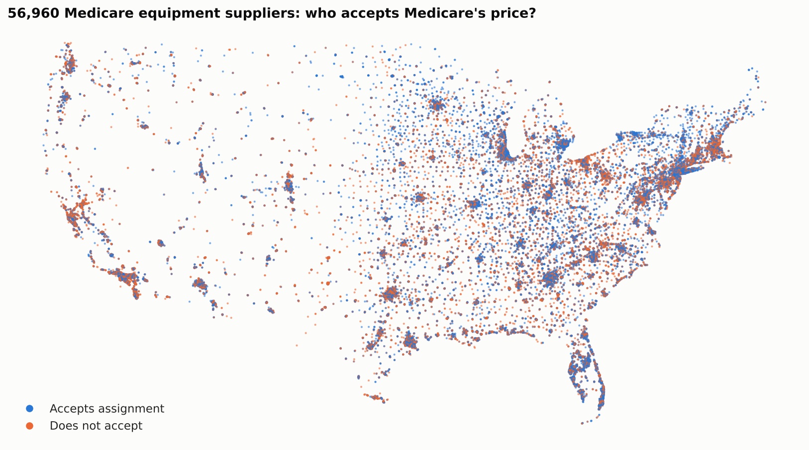

# Will Your Medical Supplier Accept Medicare's Price?

An analysis of **56,960 Medicare medical-equipment suppliers** to find out which ones *accept Medicare
assignment*, and whether we can predict it. Completed for the Udacity Data Scientist Nanodegree
("Write a Data Science Blog Post") following the **CRISP-DM** process.

📝 **Blog post:** ([#](https://medium.com/@sultanbahamburah/same-walker-different-bill-what-57-000-medicare-suppliers-reveal-about-who-accepts-medicares-7a858556a7fb))



---

## Table of contents
1. [Motivation](#motivation)
2. [Business questions](#business-questions)
3. [Libraries used](#libraries-used)
4. [Files in the repository](#files-in-the-repository)
5. [How to run](#how-to-run)
6. [Summary of results](#summary-of-results)
7. [Acknowledgements](#acknowledgements)

## Motivation

People on Medicare buy equipment such as walkers, CPAP machines, wheelchairs, diabetic supplies and
post-cataract glasses from enrolled suppliers. A supplier that **accepts assignment** agrees to take the
Medicare-approved amount as full payment, so the patient pays only the 20% coinsurance. A supplier that
doesn't can charge more. The supplier directory records this flag for every location, but patients rarely
know which kinds of suppliers tend to accept. This project uses the directory to answer that question
and builds a model that estimates the chance that a given supplier accepts assignment.

## Business questions

1. Which **types of supplier** are most and least likely to accept assignment?
2. How much does acceptance **vary by state**?
3. Is accepting assignment a **local or a corporate decision**?
4. Which **products** are hardest to find from a supplier that accepts assignment?
5. Can we **predict** whether a supplier accepts assignment, and what drives the prediction?

## Libraries used

Python 3.10+ with:

| Library | Purpose |
|---|---|
| `pandas` | Loading, cleaning and reshaping the data |
| `numpy` | Numerical operations |
| `scikit-learn` | Random forest, logistic regression, grouped cross-validation, metrics |
| `matplotlib` | Charts |
| `seaborn` | Chart styling and histograms |
| `scipy` | Chi-square tests (installed automatically with scikit-learn) |
| `jupyter` | Running the notebook |

Install with `pip install -r requirements.txt`.

## Files in the repository

```
├── medicare_supplier_assignment.ipynb   # Main analysis: full CRISP-DM notebook (executed, with outputs)
├── data/
│   └── Medical-Equipment-Suppliers.zip  # CMS Medicare Supplier Directory, zipped CSV (56,960 rows, 17 columns; pandas reads it directly)
├── images/                              # Charts saved by the notebook (used in the blog post)
│   ├── header_map.png                   # Map of every supplier coloured by assignment status
│   ├── eda_distributions.png            # Distributions/skewness of enrolment years and product counts
│   ├── q1_specialty.png                 # Q1: acceptance rate by supplier specialty
│   ├── q2_state.png                     # Q2: acceptance rate by state
│   ├── q3_chains.png                    # Q3: the 15 largest businesses and their policies
│   ├── q4_products.png                  # Q4: products least often sold on assignment
│   ├── q5_confusion_matrix.png          # Q5: model confusion matrix on unseen businesses
│   └── q5_feature_importance.png        # Q5: top 15 model features
├── blog/
│   └── blog_post.md                     # Draft of the blog post (non-technical write-up)
├── requirements.txt                     # Python dependencies
└── README.md                            # This file
```

## How to run

```bash
git clone <this-repo-url>
cd <repo-folder>
pip install -r requirements.txt
jupyter notebook medicare_supplier_assignment.ipynb   # then Kernel → Restart & Run All
```

A full run takes about 1–2 minutes on a laptop and regenerates every chart in `images/`.

## Summary of results

| Question | Finding |
|---|---|
| **Q1 Supplier type** | Supplier type matters most (χ² p < 0.001, Cramér's V = 0.28). **Optometrists (95%)** and **hospitals (98%)** almost always accept assignment; **opticians (23%)** and **medical supply companies with a respiratory therapist (24%)** rarely do. Pharmacies, 71% of all suppliers, sit near the average (53%). |
| **Q2 State** | Acceptance ranges from **37% in DC** and **38% in California** to **74% in North Dakota** and **73% in Puerto Rico** (Cramér's V = 0.16). |
| **Q3 Local vs corporate** | It's a **corporate decision**. 74% of locations belong to a multi-location business, and **98% of those businesses apply one policy at every site** (99% for chains with 10+ sites). Every Walgreens, Publix and Kroger location accepts; no Walmart or Luxottica location does, and only 16% of CVS locations do. |
| **Q4 Products** | Only about **1 in 10** suppliers of complex rehab power wheelchairs, speech-generating devices, defibrillators and advanced respiratory devices accept assignment, against 90%+ for contact and cataract lenses. |
| **Q5 Prediction** | A random forest, evaluated with **grouped 5-fold cross-validation** (no business appears in both training and test), is right **83%** of the time (ROC AUC 0.88, F1 0.81), against ~50% for random guessing. A naive random split would have reported an inflated 90% because the model memorises chains. |
| **Scenario** | For a patient needing glasses after cataract surgery, the model gives an independent optometrist a **94%** chance of accepting assignment, an independent optician **71%**, and an unseen national optical-chain store **43%** (in the data, optician chains with 100+ stores accept 0% of the time). |

### Data handling highlights
- **Missing values:** `providertypelist` (88% missing) means "no extra provider type", so it was filled as an empty list;
  missing `specialitieslist` (1.3%) became an explicit `Unknown` category because those suppliers behave differently (66%
  accept); `practiceaddress2` (78% missing) and the constant column `is_contracted_for_cba` were dropped.
- **Categorical variables:** the three `|`-separated list columns were **multi-hot encoded**; state was **one-hot encoded**.
- **Data errors:** five enrolment dates before Medicare existed (1940, 1965) were clipped to 1 July 1966.

## Acknowledgements

- Data: **Centers for Medicare & Medicaid Services (CMS)**, Medicare Supplier Directory, from the
  [CMS Provider Data Catalog](https://data.cms.gov/provider-data/). Field definitions are in the
  [Supplier Directory Data Dictionary](https://data.cms.gov/provider-data/sites/default/files/data_dictionaries/supplier/Supplier_Directory_Data_Dictionary.pdf).
- Coverage facts on post-cataract eyeglasses: [AARP: Does Medicare cover glasses?](https://www.aarp.org/medicare/faq/does-medicare-cover-glasses)
- [Udacity](https://www.udacity.com/) for the project brief and the CRISP-DM framework.
- scikit-learn documentation on [group-aware cross-validation](https://scikit-learn.org/stable/modules/cross_validation.html#group-k-fold).

This analysis is for educational purposes and is not medical, legal or financial advice. Always confirm
assignment status directly with the supplier before ordering.
