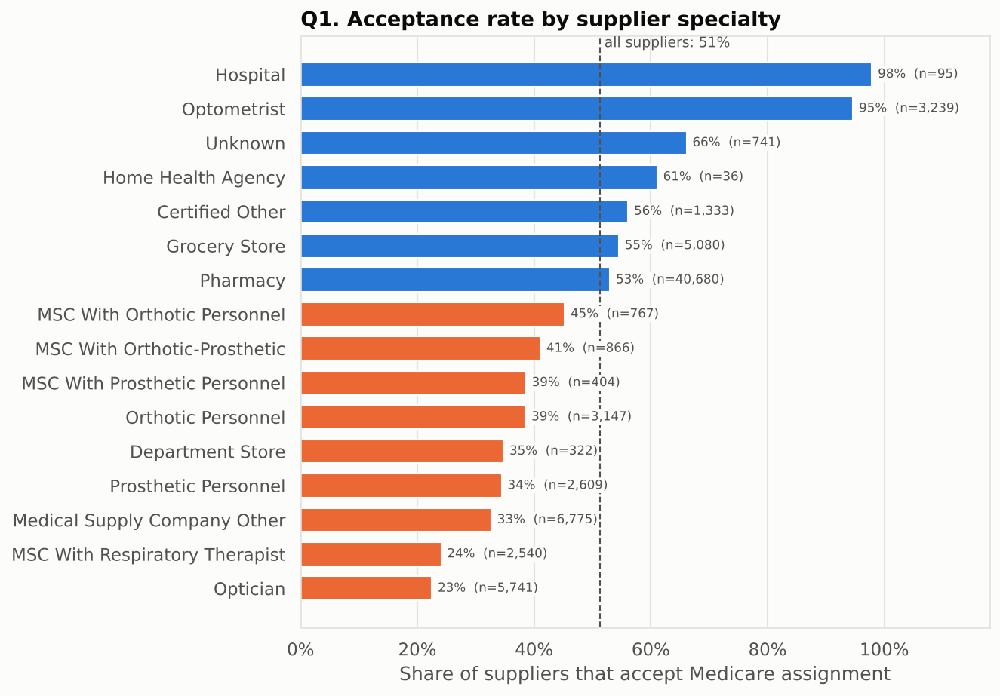
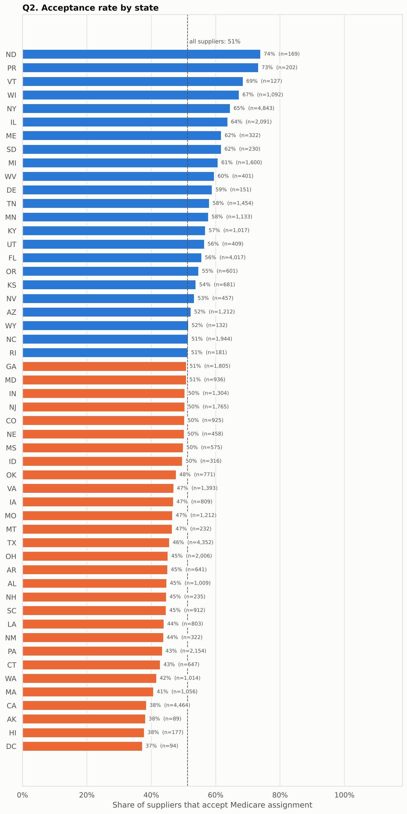
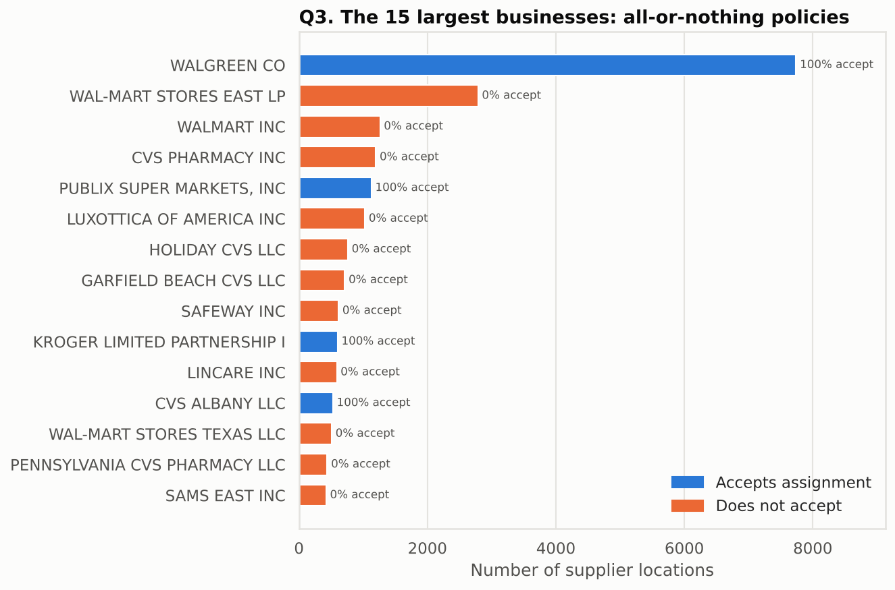
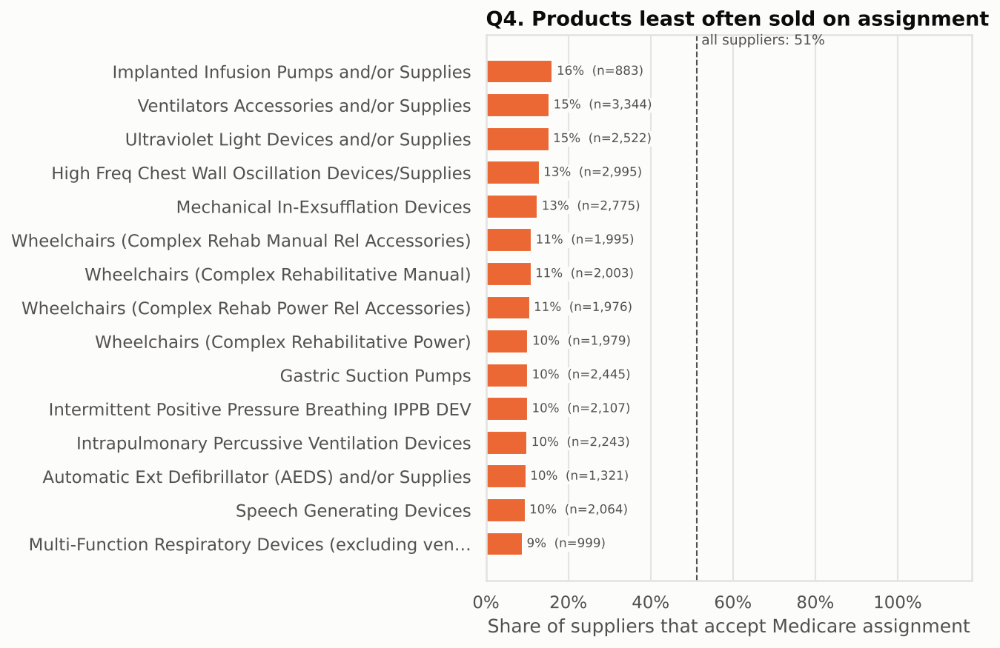

# Same Walker, Different Bill: What 57,000 Medicare Suppliers Reveal About Who Accepts Medicare's Price

*Your bill for the same piece of medical equipment can depend on the brand of the store. Here's what the data shows, and how to stay on the right side of it.*

*Every dot is a Medicare equipment supplier. Blue ones accept Medicare's approved price; orange ones don't have to.*

---

## Why one checkbox matters

If you're on Medicare and need a walker, a CPAP machine, diabetic test strips or new glasses after cataract surgery, you buy them from a Medicare-enrolled supplier. Each supplier makes one choice that affects your bill: **does it "accept assignment"?**

- **Yes:** the supplier takes Medicare's approved amount as full payment. You pay your 20% share and nothing more.
- **No:** the supplier can charge you more than Medicare's approved amount, and may ask you to pay up front.

Medicare publishes a directory of every enrolled supplier, including this flag. I analysed all **56,960 supplier locations** in it to answer five questions:

1. Which **types of supplier** are most likely to accept Medicare's price?
2. Does it depend on **which state** you live in?
3. Is it a decision made by the **local store or by head office**?
4. Which **products** are hardest to get from a supplier that accepts Medicare's price?
5. Can a **model predict** whether a supplier you've never heard of will accept?

Overall, the split is almost even: **51%** of supplier locations accept assignment and **49%** don't. The interesting part is *which* ones.

---

## 1. Your eye doctor says yes; the glasses shop often says no

The type of business is the strongest pattern in the data:

- **Optometrists: 95%** accept assignment. **Hospitals: 98%.**
- **Opticians** (glasses shops) accept only **23%** of the time.
- **Medical supply companies with a respiratory therapist**, the firms that typically supply oxygen and breathing equipment, accept just **24%** of the time.
- **Pharmacies** make up 71% of all suppliers and sit right in the middle at **53%**.

A statistical test (chi-square) confirms these differences are far too large to be chance.

**In plain terms:** if you need glasses after cataract surgery, an optometrist's office is a much safer bet than a high-street glasses shop.

---

## 2. Where you live matters, but less than you'd think

Acceptance ranges from **37% in Washington, DC** and **38% in California, Alaska and Hawaii** up to **74% in North Dakota** and **73% in Puerto Rico**. Big states differ too: **New York (65%)** and **Illinois (64%)** are well above average, while **California (38%)** and **Massachusetts (41%)** are well below.

The state effect is real but about half as strong as the supplier-type effect. As the next question shows, much of it comes from which big chains happen to dominate each state.

---

## 3. It's head office that decides

This was the biggest surprise. You might expect each store manager to decide for themselves, but the data says otherwise.

- **74%** of all supplier locations belong to a business with more than one location.
- Of the **2,312** multi-location businesses, **98%** apply **the same policy at every single location**. Among chains with 10 or more sites, it's **99%**.

And similar-looking brands make opposite choices:

| Accept assignment at **every** location | Accept at **almost none** of their locations |
|---|---|
| Walgreens (all 7,873 locations) | Walmart (0% of 4,579 locations) |
| Publix (all 1,362) | LensCrafters' parent Luxottica (0% of 1,026) |
| Kroger (all 1,205) | Lincare and Safeway (under 1% of ~600 each) |
| | CVS (16% of 8,137: most of its 52 legal entities say no) |

**In plain terms:** the logo on the door tells you more than the address. Two pharmacies on the same street can give you very different bills for the same item.

---

## 4. The most expensive equipment is the hardest to get at Medicare's price

For each product category, I looked at what share of the suppliers offering it accept assignment. The bottom of the list is worrying:

- Only about **1 in 10** suppliers of **complex power wheelchairs**, **speech-generating devices**, **defibrillators** and **advanced breathing devices** accept assignment.
- By contrast, **contact and cataract lenses (90%+)** and **tube-feeding nutrition (95%)** are almost always available at Medicare's price.

The items where paying above the approved amount would hurt most are also the ones where you have the fewest options.

---

## 5. Can we predict it? Mostly, and we know when to be careful

I trained a **random forest**, a model made of hundreds of decision trees voting together. It looks at a supplier's type, the products it sells, its state, how long it has been enrolled, and how many locations the business has.

There was one trap to avoid. Because chains are all-or-nothing, a model tested on a random sample of stores can "cheat": it learns "Walgreens = yes" from some Walgreens stores and gets the others right for free. Tested that way, the model looked **90%** accurate. So I tested it more strictly, on **entire businesses it had never seen** (a technique called grouped cross-validation).

The honest results:

| Measure | Result | What it means |
|---|---|---|
| **Accuracy** | **83%** | Right about 5 times out of 6 for unfamiliar businesses (random guessing gets ~50%) |
| **Precision** | **78%** | When it says "accepts", it's right about 4 times in 5 |
| **Recall** | **87%** | It finds nearly 9 in 10 of the suppliers that do accept |
| **ROC AUC** | **0.88** | Given one supplier that accepts and one that doesn't, it ranks them correctly 88% of the time |

*Accuracy and ROC AUC are averaged over five rounds of testing on unseen businesses. Precision and recall come from a final held-out test set of 3,404 unseen businesses.*

The most useful signals were **chain size**, **how long the supplier has been enrolled** and **how many product types it sells**, followed by particular product lines, location (New York stands out) and being an optometrist.

---

## Putting the model to work: Fatima needs new glasses

*Fatima is 72 and lives in Toledo, Ohio. She has just had cataract surgery. Medicare Part B covers one pair of glasses with standard frames (or one set of contacts) after this surgery, as long as she buys from a Medicare-enrolled supplier. She has three options nearby.*

| Supplier | Model's chance it accepts assignment | What real suppliers like this do |
|---|---|---|
| **A.** Independent optometrist's practice | **94%** | 94% of independent optometrists accept |
| **B.** Independent optician's shop | **71%** | 66% of independent opticians accept |
| **C.** Store of a national optical chain (~1,000 stores) | **43%** | 0% of optician chains with 100+ stores accept |

How to read this:

- **Supplier A is the safe choice.** The model is confident, and the real-world data agrees.
- **Supplier B is a decent bet**, but worth a quick phone call.
- **Supplier C gets a near coin-flip.** That isn't the model saying "maybe". It's the model saying *"I don't know this chain's corporate policy."* Since every store in a chain follows the same rule, the answer is really yes or no. The data adds a warning: large optical chains almost never accept assignment.

**My advice to Fatima:** go to the optometrist. If she prefers the chain store, she should ask one question before ordering: ***"Do you accept Medicare assignment?"***

---

## The takeaways

1. **Ask before you buy.** It's a yes/no question, and it can save you money.
2. **The type of supplier matters most.** Optometrists and hospitals almost always accept; opticians and respiratory-equipment firms usually don't.
3. **The brand matters more than the store.** Chains set one policy for every location.
4. **Big-ticket equipment is the hardest to get at Medicare's price.** Shop around for power wheelchairs and breathing devices.
5. **A model can narrow the field to about 83% accuracy**, but the supplier's own answer is final.

---

*The full analysis, code and data are on GitHub: [link to your repository here](#). Data: Centers for Medicare & Medicaid Services (CMS), Medicare Supplier Directory. This post is for information only and isn't medical, legal or financial advice.*
